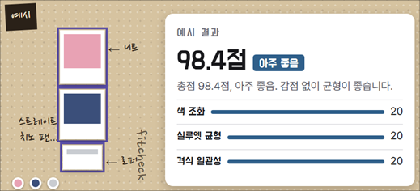

# 핏체크 | AI 착장 평가 서비스

입으려는 옷이나 구매를 고민하는 상품이 지금 가진 옷과 어울리는지 확인할 수 있는 웹 서비스입니다. 착장 사진이나 상품 링크를 넣으면 색 조합과 실루엣 등을 7개 기준으로 평가하고, 점수와 함께 개선할 부분을 알려줍니다.

- **역할** | 1인 기획, 개발, 배포 및 운영
- **기간** | 2026년 9월부터
- **서비스** | [핏체크 열기](https://fitcheck-jin-project2.vercel.app/) · 로그인 없이 소개와 평가 예시를 볼 수 있습니다. 직접 분석은 초대 베타에서 이용할 수 있습니다.

## 어떤 문제를 풀었나요?

이미 가진 옷의 조합이 괜찮은지 확인하고 싶을 때는 구체적인 피드백을 빠르게 받기 어렵습니다. 핏체크는 사용자가 고른 조합을 평가하고, 점수의 근거와 다음에 바꿔볼 부분을 함께 보여주도록 기획했습니다.

## 사용 흐름

1. 상의, 하의, 신발 사진이나 상품 링크로 착장을 구성합니다.
2. 총점과 등급, 색 조화·실루엣·격식 등을 포함한 7개 기준별 근거를 확인합니다.
3. 개선 제안을 참고하고, 분석 결과를 착장함에서 다시 확인합니다.

## 평가 방식과 검증

AI가 이미지에서 색, 소재, 핏 같은 속성을 추출하고, 규칙 엔진이 추출한 속성으로 점수를 계산합니다. 같은 속성에는 같은 기준을 적용하며, 점수에 영향을 준 항목을 결과에 표시합니다.

- **등급 기준 보정** | 13,440개 조합을 규칙 엔진으로 채점하고, 사람이 평가한 착장 46벌과 대조해 등급 기준을 조정했습니다.
- **품질 검증** | 채점 규칙과 서비스 동작을 확인하는 자동 테스트 829개를 구성했습니다.
- **응답 속도** | 평가 결과의 문장 생성 단계에서 12~21초 걸리던 시간을 개선 후 측정 중앙값 5.8초로 줄였습니다.

**사용 기술** | Next.js, TypeScript, Claude Code, Vercel

